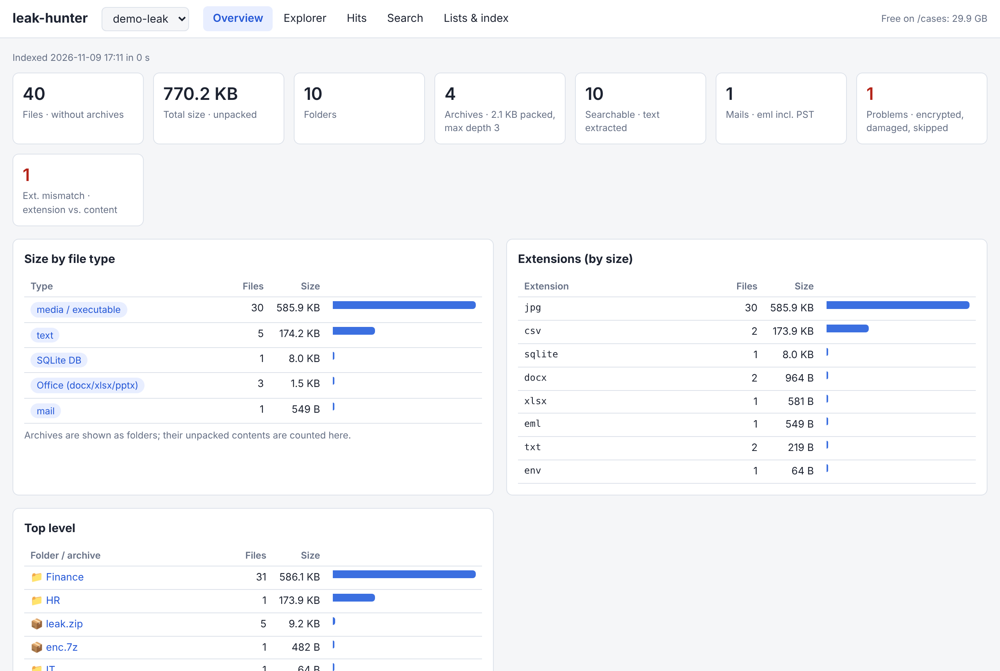

# Home Malware Analysis Lab

A self-hosted analysis lab on one old desktop PC: Proxmox runs isolated VMs for email, document and malware analysis, and every analysis VM reaches the internet **only** through a firewall VM and a commercial VPN tunnel. Samples are executed in a second, fully offline network with a simulated internet.

Built step by step by a SOC analyst for home use: link and phishing analysis, document and email triage, Windows malware analysis, safe detonation with network capture, data leak analysis, disposable browsers and a Kali box for CTFs. This repo documents the whole setup so you can build your own version.

> **Disclaimer:** Handling live malware is risky. Use this only on dedicated hardware, keep samples zipped and password-protected, never run samples outside the offline network, check the terms of your VPN provider, and if samples come from your job, make sure your employer allows analysing them at home. No warranty, use at your own risk.

## What you get

| Network | Purpose | VMs |
|---|---|---|
| **Home LAN** | Management only | Proxmox web UI, OPNsense GUI |
| **vmbr1** (analysis) | Internet **only via VPN**, no access to home LAN or firewall, kill switch | REMnux, FLARE-VM, Kasm, Kali, leak analysis |
| **vmbr2** (detonation) | **No internet at all**, REMnux + INetSim play "the internet", every packet is captured | REMnux (INetSim), FLARE-VM (victim) |

```
Internet
   │
Home router <HOME_GW> (home LAN <HOME_LAN>)
   │
nic0 ── vmbr0 ── Proxmox host <PVE_IP> (web UI :8006, transfer UI :8443)
           │
           └── OPNsense WAN <OPN_WAN_IP>  ──port forward 8443──► Kasm
                    │
               WireGuard tunnel ──► VPN provider (e.g. Proton VPN)
                    │
               OPNsense LAN 10.10.10.1/24 (DHCP .100-.200)
                    │
               vmbr1  (no physical port)
                    │
     ┌──────────────┼───────────────┬───────────────┬──────────────┬──────────────┐
  REMnux 301    FLARE-VM 401     Kasm 500        Kali 600       Leak 700
  (email/docs)  (Windows RE)     (10.10.10.20)   (CTFs)         (leak-hunter)


vmbr2  (no physical port, no router, no internet)
     ├── REMnux 302 "inetsim"   10.20.20.1   fake DNS/HTTP/SMTP..., gateway, PCAP capture
     └── FLARE-VM 402 "detonate" 10.20.20.10  runs the samples

Sample transfer 301 → 402: read-only ISO built on the Proxmox host via QEMU guest agent (no network path)
```

### Security model in short

- Analysis VMs sit on an internal bridge without a physical port. The only way out is the OPNsense VM.
- OPNsense policy-routes the analysis network into the WireGuard tunnel. If the tunnel is down, the rule is skipped and traffic is **dropped** (kill switch), never sent via the home IP.
- DNS for the analysis network is forwarded through the tunnel (no DNS leaks), IPv6 is blocked.
- Analysis VMs cannot reach the home LAN or the OPNsense GUI.
- Samples are only **executed** on vmbr2, which has no route anywhere. INetSim answers every DNS name and connection, so samples reveal their C2 domains and URLs, and tcpdump records everything.
- Samples travel into the detonation VM as a read-only CD image, so nothing can be written back.
- Every analysis VM is a linked clone of a template with a `clean` snapshot; roll back after each case.

## Components

| ID | VM | Role |
|---|---|---|
| 100 | OPNsense | Firewall, VPN gateway, DHCP/DNS for vmbr1 |
| 9000 | REMnux template | Linux malware/email/document analysis toolkit (+ EML Analyzer pinned to a working version, CyberChef, Firefox policy) |
| 9011 | FLARE-VM template | Windows 10 with Mandiant FLARE-VM |
| 301 | REMnux work clone | Daily analysis on vmbr1 |
| 401 | FLARE work clone | Static analysis / RE on vmbr1 (do not run samples here) |
| 302 | REMnux INetSim clone | Fake internet + PCAP on vmbr2 |
| 402 | FLARE detonation clone | Executes samples on vmbr2 |
| 500 | Kasm Workspaces | Disposable Chrome/Firefox/Tor sessions in the browser |
| 600 | Kali | Persistent box for CTFs |
| 700 | Leak analysis | Ubuntu Desktop, LUKS-encrypted case volume, ICIJ Datashare, leak-hunter |

Plus two small tools:

- **Sample Transfer UI** on the Proxmox host ([tools/transfer-ui](tools/transfer-ui/)): list files in 301, send one to 402 as ISO, start VMs, roll back 402.
- **leak-hunter** in VM 700 ([tools/leak-hunter](tools/leak-hunter/)): overview of a data leak (file types, sizes, folder tree incl. archive contents), interactive hit reader, ad-hoc search, keyword lists per customer with separate HTML + CSV reports. Python standard library + ripgrep, 7-Zip, pdftotext, readpst, mdbtools.
- **leak-dl** ([tools/leak-dl](tools/leak-dl/)): cloud-init for a disposable download VPS (`.onion` via Tor, clearnet direct), `leak-fetch` (resume, retries, parallel Tor circuits, mirror) and `leak-pull` (rsync into the leak VM, read-only key, hash check).



## Placeholders

Replace these with your own values everywhere in the docs:

| Placeholder | Meaning | Example |
|---|---|---|
| `<HOME_LAN>` | Your home network | `192.168.1.0/24` |
| `<HOME_GW>` | Your home router | `192.168.1.1` |
| `<PVE_IP>` | Static IP of the Proxmox host (outside the router's DHCP range) | `192.168.1.10` |
| `<OPN_WAN_IP>` | OPNsense WAN address (DHCP reservation on your router) | `192.168.1.11` |

The internal subnets `10.10.10.0/24` (analysis) and `10.20.20.0/24` (detonation) are only examples; they must not overlap with your home LAN. **Important:** OPNsense's default LAN IP is `192.168.1.1`. If that is your router's address too, configure OPNsense with its WAN NIC disconnected first (see [04](docs/04-opnsense.md)), or it will take over your home network.

## Build order

1. [Hardware and BIOS](docs/01-hardware.md)
2. [Proxmox installation](docs/02-proxmox-install.md)
3. [Storage and networking](docs/03-storage-network.md)
4. [OPNsense VM](docs/04-opnsense.md)
5. [VPN via WireGuard (Proton VPN example)](docs/05-protonvpn-wireguard.md)
6. [Firewall, NAT, kill switch, DNS](docs/06-firewall-rules.md)
7. [Verification tests](docs/07-testing.md)
8. [Troubleshooting and lessons learned](docs/08-troubleshooting.md)
9. [Backup and recovery](docs/09-backup-recovery.md)
10. [REMnux template](docs/10-remnux-template.md)
11. [FLARE-VM template](docs/11-flarevm.md)
12. [Offline detonation network](docs/12-offline-detonation.md)
13. [Sample Transfer UI](docs/13-transfer-ui.md)
14. [Kasm Workspaces](docs/14-kasm.md)
15. [Kali VM](docs/15-kali.md)
16. [Leak analysis VM](docs/16-leak-analysis.md)

Further ideas: [IDEAS.md](IDEAS.md)

Rough time: Proxmox + OPNsense + VPN one evening, each analysis template one evening (FLARE-VM installs for 1 to 2 hours on its own).

## Typical workflows

**Suspicious email or link:** download the `.eml` in REMnux 301, open EML Analyzer (local), check links with `curl -sIL`, open them in a disposable Kasm browser, roll back 301.

**Office/PDF/script sample:** static analysis in REMnux 301 (oletools, pdf tools, CyberChef) or FLARE 401. Do not execute.

**Data leak (e.g. ransomware leak site):** browse the leak site in a Kasm Tor Browser, download on the VPS with `leak-fetch`, `leak-pull` into VM 700's encrypted case volume (or copy smaller archives via the CD route), index it in leak-hunter, check the overview and problem list, run one keyword list per customer, work through the hits (filter, flag, view context), export one report per customer. Scanned documents: Datashare with OCR.

**Executable / dynamic behaviour:** start 302, run `detonate-start.sh` (INetSim + PCAP), send the zip to 402 via the transfer UI, execute and watch with Procmon/Process Explorer, stop INetSim, read the INetSim report and the PCAP (Wireshark/NetworkMiner), roll back 402.

## Requirements

- Desktop with VT-x/AMD-V, 16 GB RAM minimum (32 GB comfortable), two SSDs recommended
- Proxmox VE 9, OPNsense 26.x, a VPN provider with WireGuard configs (Proton VPN used here)
- Windows 10 ISO for FLARE-VM (runs unactivated)
- Basic Linux shell skills; everything else is explained step by step

## Secrets

Never commit VPN configs, private keys, passwords or OPNsense config exports. The `.gitignore` blocks common file types.

## License

MIT, see [LICENSE](LICENSE). Third-party tools (Proxmox, OPNsense, REMnux, FLARE-VM, INetSim, Kasm, Kali, ...) keep their own licenses; Kasm Community Edition is for non-commercial use.
