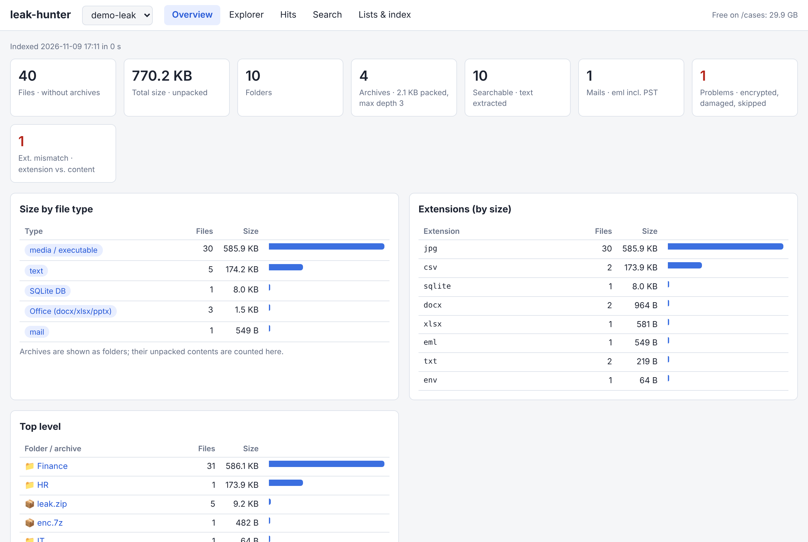

# 16 Leak analysis VM (700)

VM for analysing leaked data (e.g. ransomware leak-site dumps): an encrypted case volume, ICIJ Datashare for full-text exploring, and **leak-hunter** (own tool in [tools/leak-hunter](../tools/leak-hunter/)) for the leak overview, file explorer, interactive hit reader and keyword reports per customer.

> Leaks are stolen personal and customer data. Only analyse what your employer allows, keep it encrypted, delete it when the case is closed.

## Getting leak data into the VM

Simplest: the read-only CD route from [12](12-offline-detonation.md) (files > 4 GB need `genisoimage -udf -allow-limited-size`, see "Large files" below), in 700 `sudo mount -o ro /dev/sr0 /mnt/cd`.

Large dumps: a cloud VPS downloads from the leak site (`.onion` via Tor, clearnet directly or via Tor), VM 700 pulls the result via rsync/SSH with a read-only key. One OPNsense rule lets only 700 → VPS:22 bypass the VPN (VPN providers often throttle large downloads). Your home IP never touches the leak site. Setup and scripts: [tools/leak-dl](../tools/leak-dl/README.md).

## VM

| Setting | Value |
|---|---|
| ID / name | 700 `leak-analysis` |
| OS | Ubuntu 26.04.1 Desktop, user `analyst` |
| CPU / RAM | 4 cores host, 12 GB, ballooning off |
| Disk scsi0 | 60 GB `nvme` (system) |
| Disk scsi1 | 300 GB `nvme`, **Backup unticked**, LUKS2 → `/cases` |
| Network | vmbr1, static IP (e.g. `10.10.10.70`, needed for the download VPS rule) |
| Console | noVNC, clipboard works (Proxmox clipboard panel) |

The RAM is mainly for Elasticsearch (Datashare). Without Datashare, 6 to 8 GB are enough.

Rules:

- **No snapshots on 700.** A snapshot would keep leak data after deletion and blocks resizing the data disk. Back up with vzdump (data disk excluded).
- RAM: don't run 700, 401 and Kasm at the same time (32 GB host).
- Paste tip: run `sudo -v` before pasting a block, otherwise the sudo prompt can swallow the next pasted line.

## Install

```bash
sudo apt update && sudo apt -y full-upgrade
sudo apt install -y qemu-guest-agent cryptsetup 7zip pst-utils ripgrep jq sqlite3 \
  poppler-utils mdbtools libimage-exiftool-perl file tree python3-venv python3-pip \
  docker.io docker-compose-v2
sudo apt install -y curl wget rsync openssh-client net-tools dnsutils \
  iputils-ping traceroute netcat-openbsd htop unzip git vim tmux ca-certificates
sudo systemctl start qemu-guest-agent
```

Ubuntu Desktop ships without curl, rsync, net-tools and similar; the second line adds the essentials.

Static IP: set it in Settings → Network → Wired → IPv4 Manual and reconnect, otherwise the DHCP lease stays as a secondary address. Fix in the terminal: `nmcli con mod "<connection>" ipv4.method manual ipv4.addresses 10.10.10.70/24 ipv4.gateway 10.10.10.1 ipv4.dns 10.10.10.1 ipv4.ignore-auto-dns yes && nmcli con up "<connection>"`.

## Encrypted data disk `/cases`

Why: deleted files stay on thin volumes/SSD until overwritten; with LUKS everything is ciphertext, so the host, other VMs, a stolen or disposed box and leftovers after deletion reveal nothing. Datashare's Elasticsearch index holds the full text of every document, so Docker's data root lives on `/cases` too. Passphrase in the password manager; lost passphrase = lost data.

```bash
lsblk -d -o NAME,SIZE                       # 300G disk = sdb
sudo cryptsetup luksFormat --type luks2 /dev/sdb
sudo cryptsetup open /dev/sdb cases
sudo mkfs.ext4 -m 0 -L cases /dev/mapper/cases
sudo mkdir -p /cases && sudo mount /dev/mapper/cases /cases && sudo chown analyst:analyst /cases
sudo systemctl disable --now docker docker.socket
echo '{ "data-root": "/cases/docker" }' | sudo tee /etc/docker/daemon.json
```

`cases-open` / `cases-close` and a login starter are in [tools/leak-vm](../tools/leak-vm/README.md) (`bash tools/leak-vm/install.sh` in the VM). `cases-open` also handles a disk that the desktop already unlocked under `/media/...`, and a udev rule hides the LUKS disk from the dock so it is not unlocked there.

Daily: boot → login → terminal asks for sudo password + passphrase → Firefox opens leak-hunter → work → app menu **Close cases** → shut down. Manually: `cases-open` / `cases-close`.

## Datashare

ICIJ Datashare (local mode) in Docker: full-text search, previews, named entities, optional OCR. Web UI only inside the VM: http://localhost:8080 (Firefox in 700).

```bash
echo 'vm.max_map_count=262144' | sudo tee /etc/sysctl.d/99-elasticsearch.conf && sudo sysctl --system >/dev/null
mkdir -p /cases/datashare/docs
```

`/cases/datashare/docker-compose.yml`:

```yaml
services:
  datashare:
    image: icij/datashare:18.1.3
    hostname: datashare
    ports:
      - "127.0.0.1:8080:8080"
    environment:
      - DS_DOCKER_MOUNTED_DATA_DIR=/home/datashare/data
    volumes:
      - ./docs:/home/datashare/data
      - datashare-models:/home/datashare/dist
    command: >-
      --mode LOCAL
      --dataSourceUrl jdbc:postgresql://postgresql/datashare?user=datashare
      --tcpListenPort 8080
      --elasticsearchAddress http://elasticsearch:9200
      --redisAddress redis://redis:6379
      --messageBusAddress redis://redis:6379
      --defaultProject local-datashare
      --rootHost http://localhost:8080
    depends_on: [postgresql, redis, elasticsearch]
  elasticsearch:
    image: docker.elastic.co/elasticsearch/elasticsearch:7.9.1
    restart: on-failure
    environment:
      - discovery.type=single-node
      - cluster.name=datashare
      - http.cors.enabled=true
      - http.cors.allow-origin=*
      - "ES_JAVA_OPTS=-Xms3g -Xmx3g"
    volumes:
      - elasticsearch-data:/usr/share/elasticsearch/data
  redis:
    image: redis:4.0.1-alpine
    restart: on-failure
  postgresql:
    image: postgres:12-alpine
    environment:
      - POSTGRES_USER=datashare
      - POSTGRES_PASSWORD=datashare
      - POSTGRES_DB=datashare
      - POSTGRES_HOST_AUTH_METHOD=trust
    volumes:
      - postgresql-data:/var/lib/postgresql/data
volumes:
  datashare-models:
  elasticsearch-data:
  postgresql-data:
```

`cd /cases/datashare && sudo docker compose up -d` (done by `cases-open`). Start takes 1 to 2 minutes.

Per case: one folder `/cases/datashare/docs/<case>`, index it in the Datashare UI. Case closed: delete the folder and its documents in Datashare.

### Pitfalls hit during setup

| Symptom | Cause | Fix |
|---|---|---|
| Nothing on :8080, container `Up`, log `Unsupported class file major version 61` | Follow-up error hiding the real Guice error | `docker compose logs datashare \| grep -iE "caused by\|error" \| grep -v "major version"` |
| Datashare looks for ES/Redis on localhost | Addresses not set | `--elasticsearchAddress`, `--redisAddress`, `--messageBusAddress` |
| `PSQLException: ... password-based authentication, but no password was provided` | `&password=` in the JDBC URL is cut off by the entrypoint shell (`&`) | `POSTGRES_HOST_AUTH_METHOD=trust` (Postgres has no published port), URL `?user=datashare` only, `docker compose down -v` once (pg_hba is written only at first init) |

## leak-hunter

Own tool, details, screenshots and how it works: [tools/leak-hunter](../tools/leak-hunter/README.md). Web UI http://localhost:8090 in 700, started and stopped by `cases-open` / `cases-close`.



In short:

1. **Index** (once per case): inventory of every file (real type from magic bytes, size, SHA256), archives unpacked with `7z` (nested, passwords), PST split with `readpst`, mails with attachments as files, Office/ODF/PDF/SQLite/Access converted to text (`pdftotext`, `mdbtools`, Python), old Office and other binaries via strings. Plain text is searched in place.
2. **Hunt / search**: `ripgrep` over all text plus file names. Keyword lists per customer (paste or import, comma/newline separated, `re:` for regex), each hunt stored with keyword, file, line and context.
3. **UI**: Overview (types, sizes, top folders, problems), Explorer (folder tree incl. archive contents), Hits (reader with keyword filter, text filter, flags, context viewer, exports CSV / HTML / one HTML per keyword), Search (ad-hoc).

Not `rga`: conversion happens once at indexing instead of on every search, and leak-hunter adds the inventory, archive passwords and line numbers in the original file.

Persistence: everything stays on `/cases/leak-hunter/<case>/` across reboots. Lost only by re-indexing (hunts must be run again), Close case, shutting down during indexing, or losing the LUKS passphrase. `/cases` is not backed up, so keep the original leak archive until the case is closed.

Datashare vs leak-hunter: Datashare for exploring (full text, previews, entities, OCR for scans), leak-hunter for the overview and reporting (file, row/line, context per keyword, separate report per customer list).

## Large files via CD route

- Files > 4 GB: `genisoimage -quiet -J -R -udf -allow-limited-size -V SAMPLE -o <iso> <dir>`
- Archive + ISO need twice the space. Do not build them on the Proxmox root storage `local` (often only ~100 GB, a full root breaks the host). Use a storage with space that allows ISOs, e.g. a directory storage on a spare thin volume: `pvesm set <storage> --content backup,iso`, ISO into `<path>/template/iso/`, attach as `<storage>:iso/sample-transfer.iso`. The same ISO can be attached to several VMs (read-only).
- Unpacked leaks can be 30x the archive size. Check the thin pool (`lvs`) before unpacking, a full thin pool stops all VMs.
