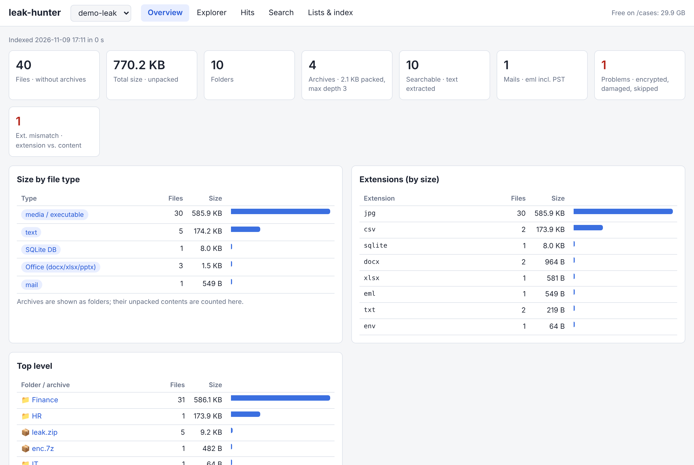
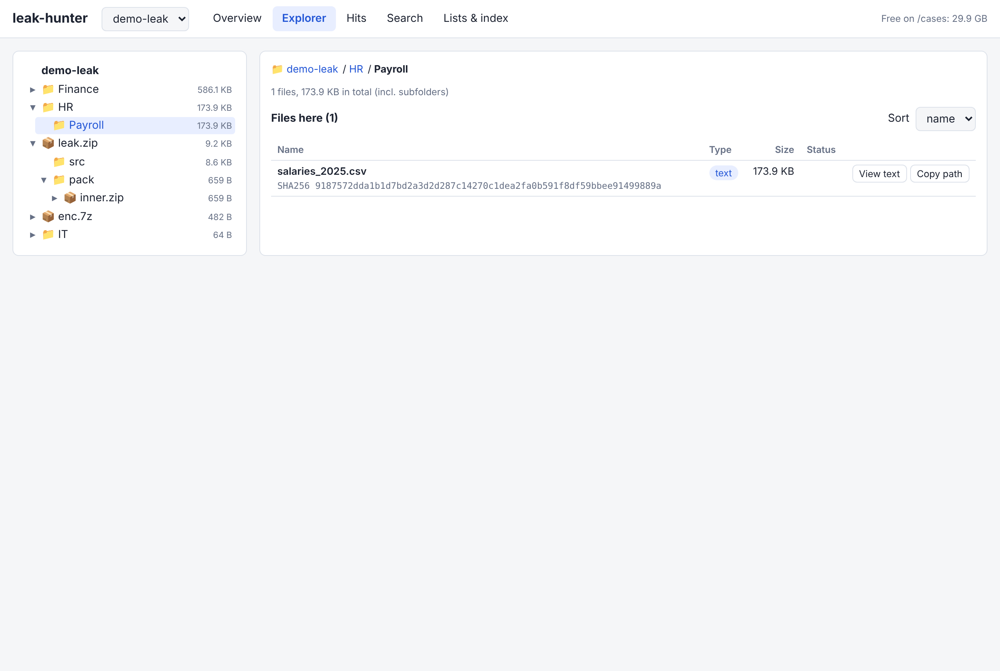
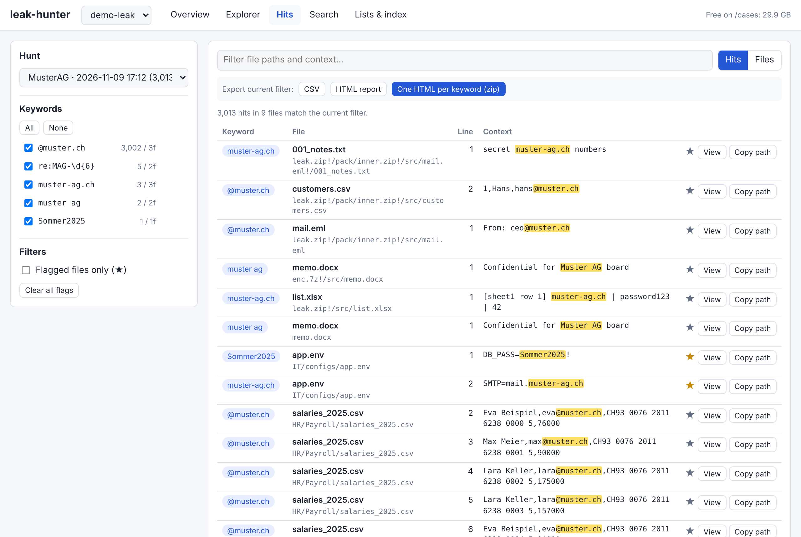
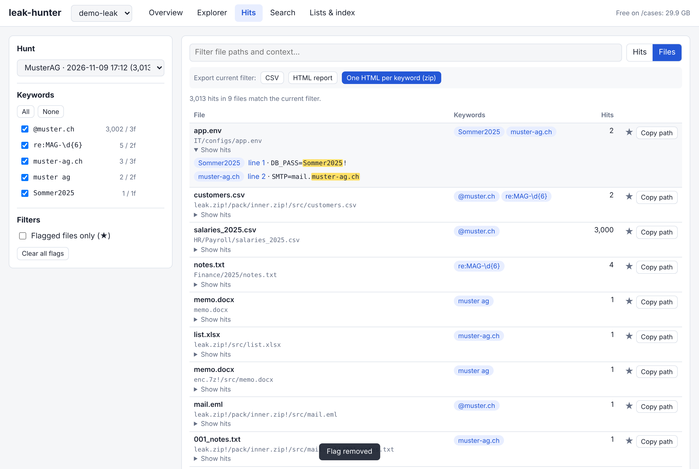
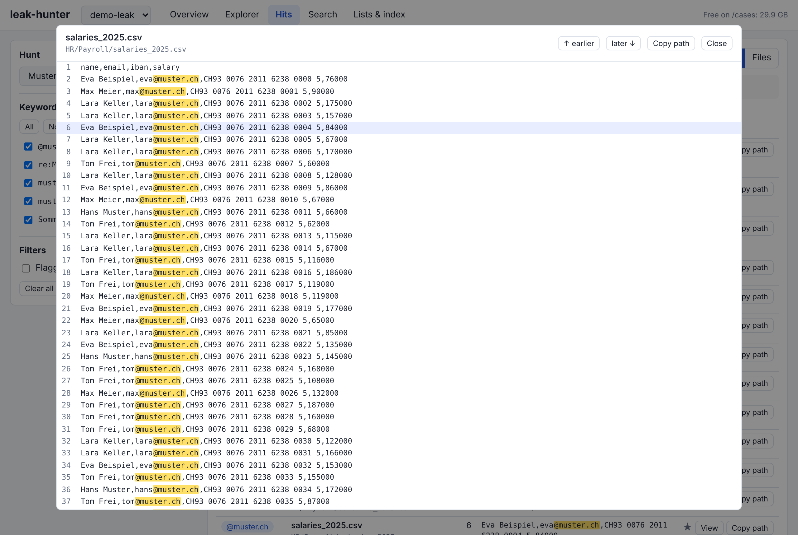
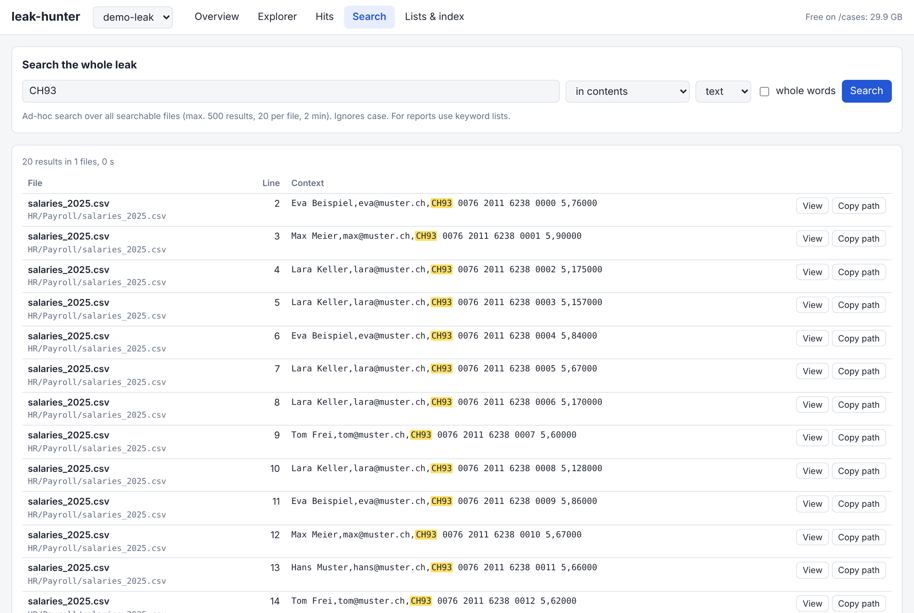
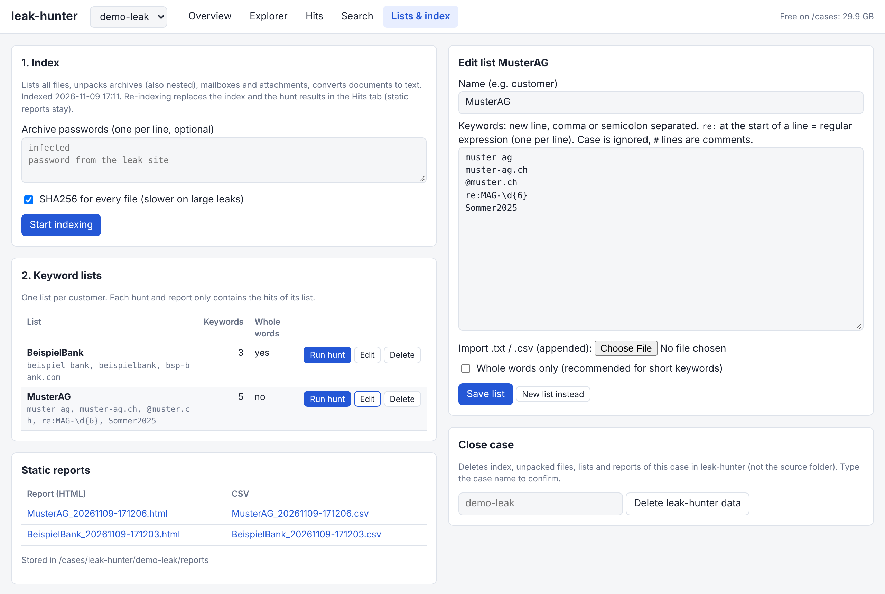

# leak-hunter

Local web tool for analysing data leaks (e.g. ransomware leak-site dumps) on the leak analysis VM: overview of the whole leak, file explorer, interactive hit reader, ad-hoc search, and keyword lists per customer with a separate HTML + CSV report per list.

Part of the leak analysis VM ([docs/16](../../docs/16-leak-analysis.md)). Runs as user `analyst` on http://localhost:8090 inside the VM, only while the encrypted `/cases` volume is unlocked. Files from the leak are only read by parsers, never opened, rendered or executed.



## Tools it uses

| Tool | Package (Ubuntu) | Used for |
|---|---|---|
| Python 3 (standard library only) | `python3` | Web server and UI, inventory, SQLite index, Office/ODF parsing (`zipfile` + XML), mail (`email`, `mailbox`), SQLite dumps, reports |
| ripgrep `rg` | `ripgrep` | The actual search: keywords, regex and ad-hoc search over all text |
| 7-Zip `7z` | `7zip` | Unpacking zip, 7z, rar, tar, gz, bz2, xz, cab, ... (also nested, with passwords) |
| `pdftotext` | `poppler-utils` | Text layer of PDFs |
| `readpst` | `pst-utils` | Outlook PST/OST into single mails |
| `mdb-tables`, `mdb-export` | `mdbtools` | Microsoft Access databases |

No pip packages, no internet access needed at runtime. The UI is a single page (`ui.html`) that talks to a small JSON API in `app.py`.

## How it works

Two phases: index once, then search as often as needed.

```
 /cases/datashare/docs/<case>/        (leak as archive or folder)
            │
            ▼  1. INDEX (once per case)
 ┌──────────────────────────────────────────────────────────────┐
 │ list every file, detect the real type from the first bytes   │
 │ archives  ──7z──► unpack into extracted/, repeat (6 levels)  │
 │ PST       ──readpst──► one .eml per mail, repeat             │
 │ .eml      ──► headers + body to text, attachments as files   │
 │ docx/xlsx/pptx/odt ──► one line per paragraph / table row    │
 │ PDF       ──pdftotext──► text                                │
 │ SQLite / Access ──► one line per table row                   │
 │ doc/xls/ppt/msg, other binaries ──► ASCII + UTF-16 strings   │
 │ plain text (csv, txt, sql, json, log, ...) ──► searched as is │
 │ SHA256, size, extension vs. content check                    │
 └──────────────────────────────────────────────────────────────┘
            │  index.db (SQLite): files, folder tree, problems
            │  text/ (converted text)   extracted/ (unpacked files)
            ▼  2. HUNT / SEARCH (any time, fast)
 ┌──────────────────────────────────────────────────────────────┐
 │ file names and paths                                         │
 │ ripgrep over all text: keywords (-F, one pass), regex (one   │
 │ pass each), case-insensitive, optional whole words           │
 │ every hit: keyword, file, line, context  ──► index.db        │
 └──────────────────────────────────────────────────────────────┘
            │
            ▼
   Hits tab (filter, flag, view)   exports: CSV, HTML, one HTML per keyword
   static report per list: reports/<list>_<time>.html + .csv
```

Why not `rga` (ripgrep-all): rga converts documents on every search (or keeps its own cache). leak-hunter converts once during indexing, so later searches run on plain text, and it adds what rga does not do: a complete inventory with folder tree, sizes, types, hashes and problems, archive passwords, mail attachments and PST mails as files of their own, and row/line numbers in the original file.

Plain text files are not copied: they are searched in place, so line numbers match the original file. For converted documents the line is the paragraph, table row or mail line of the extracted text.

## UI

| Tab | What |
|---|---|
| **Overview** | Tiles (files, unpacked size, folders, archives, searchable files, mails, problems, extension mismatches), size by file type and by extension, top-level folders and archives, largest files, problem list (encrypted, damaged, skipped), mismatches |
| **Explorer** | Folder tree of the leak. Archives, PST files and mails with attachments appear as folders (`!` in paths). Per folder: subfolders with size bars, files with type, size, SHA256, status; View text, Copy path |
| **Hits** | Reader for hunt results: pick a hunt, keyword sidebar (checkbox, "only", hits/files), text filter over path and context, Hits or Files view, flag files (stored with the case), view context, export the current filter as CSV, HTML or one HTML per keyword (zip) |
| **Search** | Ad-hoc search over the whole leak: contents or file names, text or regex, whole words (max. 500 results, 20 lines per file) |
| **Lists & index** | Index (archive passwords, SHA256 on/off), keyword lists (new, edit, import, run hunt, delete), static reports, close case |













Screenshots use synthetic test data (fictional names and companies).

## Keyword lists

- One list per customer. Each hunt and report contains only the hits of its own list.
- Enter keywords separated by new line, comma or semicolon, or import a `.txt` / `.csv` (appended to the field so it can be checked before saving).
- A line starting with `re:` is a regular expression, one per line, e.g. `re:MAG-\d{6}`.
- Matching ignores case (also umlauts). "Whole words only" is recommended for short keywords.
- Lines starting with `#` are comments. Keywords shorter than 2 characters are ignored.

## Install / update (in the leak VM)

1. Download this repository as ZIP (GitHub: Code → Download ZIP) in Firefox in the VM.
2. Unlock `/cases` (`cases-open`), then:
   ```bash
   cd ~/Downloads && unzip -oq sec-lab-main.zip && bash sec-lab-main/tools/leak-hunter/install.sh
   rm -rf sec-lab-main sec-lab-main.zip
   ```

`install.sh` copies `app.py` and `ui.html` to `/opt/leak-hunter`, installs `leak-hunter.service` (not enabled at boot) and hooks start/stop into `cases-open` / `cases-close`. After an update, index existing cases again (the folder tree and the Hits tab need the new index format).

## Workflow

1. Copy the leak (archive or folder) into `/cases/datashare/docs/<case>/`. Every folder there is a case (shared with Datashare).
2. **Lists & index** → **Start indexing**. Enter archive passwords if needed. For very large leaks, untick SHA256 for the first run.
3. Check **Overview** and **Explorer**, especially the problem list (encrypted or damaged archives).
4. Create a keyword list per customer → **Run hunt** → work through the **Hits** tab, flag relevant files, export.
5. Case closed: **Close case** (deletes leak-hunter data), then delete the source folder.

## Persistence

Everything lives on `/cases/leak-hunter/<case>/` (index, text, unpacked files, lists, hunts, flags, reports) and survives reboots: `cases-open` and continue. Lost only by re-indexing (hunts must be run again, lists and static reports stay), **Close case**, shutting down during indexing (index is incomplete, start again), or losing the LUKS passphrase. `/cases` is excluded from backups on purpose, so keep the original leak archive until the case is closed.

## Not searched

- Scans and images (no OCR; use Datashare with OCR for scanned documents)
- Media and executables (inventory only)
- Unknown binaries above 64 MB, text beyond 256 MB per file (truncated)
- UTF-16 text files without BOM

Limits are constants at the top of `app.py` (`MAX_TEXT`, `MAX_STRINGS_INPUT`, `MAX_DEPTH`, `DISK_RESERVE`, `LH_WORKERS`).

## Security

- Binds to 127.0.0.1 only, Host header check (no DNS rebinding), CSRF token on all changes, strict CSP on UI and reports (reports contain no scripts).
- Archives: symlinks and paths outside the target removed after unpacking (zip slip), nesting limit, free-space check before unpacking.
- systemd: `ConditionPathIsMountPoint=/cases`, `ProtectSystem=strict`, `NoNewPrivileges`.
- Keyword lists contain customer names: they stay on `/cases`, never in a repository.

## Tested

2026-11-09 with synthetic data: nested zip in zip, password 7z (with and without password), docx, xlsx, SQLite, eml with attachment, CSV with 3000 rows, fake PDF (zip with `.pdf` extension, flagged), two lists with keywords, regex and whole words. UI with Playwright: all tabs, light and dark mode, no console errors.
